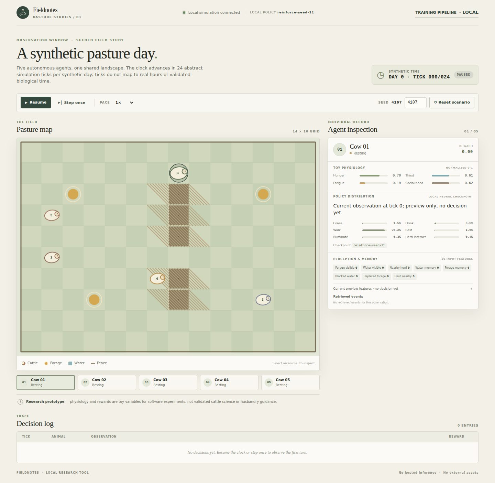
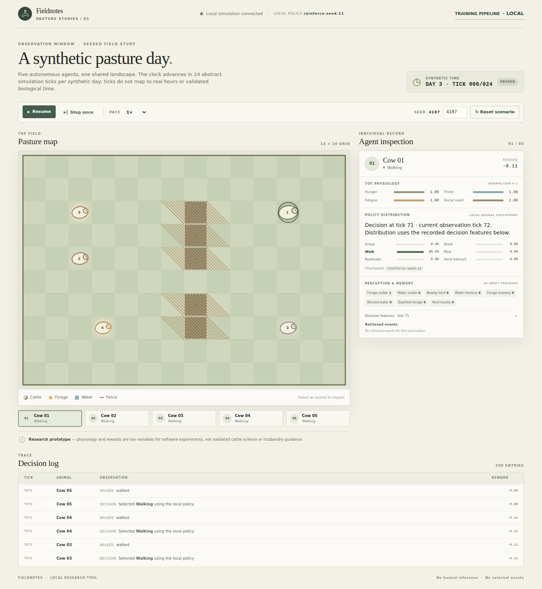
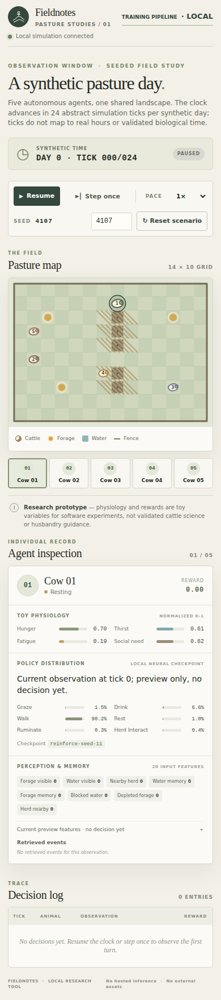

# Pasture Studies MVP 1 remediation validation report

**Final disposition: FAIL as a validated experimental platform.** Software correctness and repeatability tests, clock semantics, navigation fixtures, and browser acceptance passed, but confirmatory runtime-source provenance is **FAIL — NOT DEMONSTRATED** because runtime modules were not bound by the pre-lock attestation. The learned-policy utility gate is **INCONCLUSIVE (underpowered)** despite positive nominal estimates for one training condition; causal influence failed, and the other training condition remained collapsed and performed poorly. Biological validity is **NOT VALIDATED**. No MVP 2 work was performed.

This report records the approved MVP 1 remediation only. Rewards and action choices were not altered to force action diversity or improve a gate. All drives, rewards, and “days” below are synthetic software constructs.

## Gate summary

| Gate | Verdict | Evidence-based result |
|---|---|---|
| Software correctness / regression | **PASS** | Full regression discovery passed 59/59 after the final tests landed; compileall and JavaScript syntax checks passed. Coverage includes navigation, clock boundaries and speed invariance, training/evaluation protocol, and cognition counterfactuals. |
| Navigation remediation / reason codes | **PASS** | Reason-coded outcomes distinguish `all_target_cells_occupied`, `no_available_target`, `topologically_unreachable`, `dynamically_blocked`, `at_target`, `path_step`, and `stationary_action`. Independent fixture/oracle tests pass. The prior 5,009 aggregate was reclassified only through a reconstructed replay, not historical per-call evidence. |
| Synthetic time semantics | **PASS** | Clock contract is 24 abstract ticks per synthetic day, one action interval per tick, with physiology applied once after navigation resolution. API/UI boundary and deterministic replay checks pass. No real duration is implied. |
| Browser acceptance | **PASS** | Playwright/Chromium showed all five cattle, live inspector/API agreement, controls, seed reset/replay, three synthetic days, and a narrow layout without clipping/overlap; no console, page, or request errors. |
| Confirmatory runtime source provenance | **FAIL — NOT DEMONSTRATED** | The pre-lock attestation binds the frozen protocol, train/eval harness and its tests, seed manifest, training summary, pilot, and selected checkpoints. It does not bind the runtime modules used by rollouts (`farm_sim/simulation.py`, `policy.py`, `navigation.py`, `perception.py`, `physiology.py`, and `model.py`). Their hashes were recorded only in the final evaluation report, after outcome collection. Thus software repeatability tests pass, but pre-outcome runtime-source immutability for the locked confirmation is not established. |
| Training validity / learned-policy utility | **INCONCLUSIVE** | Ten seeds and three locked families were evaluated, but utility precision did not meet the frozen pilot target at the maximum authorized count of 60 world seeds per family. Nominal results differ substantially by training condition; see below. Do not promote either checkpoint cohort. |
| Causal cognition influence | **FAIL** | Interventions were faithful, shams bit-identical, and precision/sample gates met, but memory and perception effects were effectively zero, far below the preregistered +0.05 endpoint; matched ablations did not show meaningful attenuation. |
| Biological validity | **NOT VALIDATED** | No biological, cattle-cognition, welfare, physiology, or husbandry validation was performed. |
| Overall MVP 1 validation | **FAIL** | The complete platform gate requires software correctness/repeatability, confirmatory runtime-source provenance, learned utility, and causal influence to pass. Software checks pass, but runtime provenance is not demonstrated, utility is inconclusive, and causal influence failed. |

## What changed and how time works

The implementation adds structured navigation reason details while retaining the coarse compatibility reason, deterministic target/path selection, WALK's alternate-resource fallback, and legal adjacent herd-approach targets. It adds the explicit synthetic clock contract to simulation state/API and the UI. Clock fields include absolute tick, synthetic day index, tick within day, and ticks per virtual day. Tick 0 begins synthetic day 0; after 24 completed intervals the clock reports day 1, tick 0. Wall-clock pause/speed controls scheduling only; a direct speed-invariance test verifies that changing speed does not change the logical seeded trajectory. A separate paired replay test verifies byte-equivalent serialized state and ordered events across 100 seeds (72001–72100), each run for 72 ticks with the shipped `default-policy` checkpoint (SHA-256 `129be7419eb690bd99f55abc7c4434e30a80e818af2ebf304fcf6560d7d78cdd`). Each action occupies one abstract tick; these intervals have no calibrated real-world or biological duration.

The original WALK-collapse diagnosis did not uniquely identify a single root cause. Inference/schema checks, direct argmax agreement, probability normalization, and the tested finite-difference gradient checks passed; categorical sampling remained 97.986% WALK in the diagnostic replay. The evidence supported a narrow one-step training-task/support mismatch hypothesis, but did not isolate it as a sole causal explanation. In remediation, broader encoder-generated support produced a different collapse (HERD_INTERACT), while four-case training continued to select WALK almost exclusively. This divergence demonstrates that WALK collapse is not established as repaired generally and that changing task support does not establish effective cognition.

## Navigation results and historical-data boundary

The old evaluator retained 5,009 `no_reachable_target` outcomes as aggregate counters, not raw call-level records. The frozen-source deterministic reconstruction replayed 10,800 navigation calls and split that aggregate as follows:

| Reconstructed primary reason | Count |
|---|---:|
| `all_target_cells_occupied` | 2,385 |
| `no_available_target` | 2,624 |
| `at_target` | 3,283 |
| `path_step` | 826 |
| `stationary_action` | 1,682 |
| `topologically_unreachable` / `dynamically_blocked` | 0 |

The two reconstructed categories recombine exactly to the historical 5,009 aggregate. This is **not** an exact historical per-call classification: there are no historical call rows with matching provenance. The reconstructed replay found no obstacle-only unreachable destination in those replayed cases; that does not imply that all layouts are connected. Fixture tests include true disconnection and distinguish it from absent targets and occupancy. The previously identified defects were WALK's failure to try water when forage candidates existed but could not be used, and herd interaction targeting occupied cattle cells. Genuine absent/depleted resources and transient occupancy remain valid no-target outcomes, not pathfinder defects.

## Locked policy training/evaluation

Harness/protocol status is `FULL_PREREGISTERED`; this denotes the training/evaluation harness protocol and is distinct from the failed/not-demonstrated pre-lock runtime-source provenance gate above. Manifest SHA-256 is `b489f0d2bb0bd8796f5e9e0013c8c4a5c8558bd5d926a1b82a72a9379f400d1b`. The locked evaluation used ten training seeds (11001–11010), same-seed untrained initializations, a deterministic heuristic, three predeclared families, paired episode/world seeds, and 72 ticks per episode (three complete synthetic days). It retained 30 primary test seeds plus the first 30 authorized reserve seeds in each family (60 total); all candidates, raw per-tick rows, and policy groups were retained. The independent unit is the paired world/checkpoint episode cell; crossed-bootstrap confidence intervals and two-way cluster-robust sensitivity are in the JSON report. No action-diversity threshold was applied.

### Encoder-generated wider-support objective

Nominal paired mean-return differences were positive against both baselines in all families:

| Family | Trained − untrained (95% CI) | Trained − heuristic (95% CI) |
|---|---:|---:|
| Starter 14×10 | +26.800 [20.225, 34.524] | +52.516 [51.040, 53.907] |
| Resource-scarce / relocated | +25.664 [19.243, 33.735] | +52.990 [51.878, 54.133] |
| Wide grid 20×14 | +24.479 [18.512, 31.042] | +48.139 [46.871, 49.600] |

These positive nominal estimates do **not** pass the preregistered learning gate: the precision pilot target was not met at the maximum allowed 60 worlds per family (`all_precision_gates_met=false`), so the report labels overall utility `INCONCLUSIVE_UNDERPOWERED`. The learned policy chose `HERD_INTERACT` on 100% of its 216,000 recorded animal-tick decisions **per family** (648,000 total across three families). Its mean final hunger and thirst were both 1.0, with fatigue and social need 0.0. It mostly remained at target. Thus the positive toy-return comparison is not evidence of balanced behavior or biological welfare; the policy has collapsed to a single action.

### Four-case current objective

The trained policy selected WALK for 99.90% of starter decisions, 99.18% of resource-scarce decisions, and 99.85% of wide-grid decisions. It underperformed the same-seed untrained baseline in all three families:

| Family | Trained − untrained (95% CI) | Trained − heuristic (95% CI) |
|---|---:|---:|
| Starter 14×10 | −23.028 [−29.616, −15.369] | +2.688 [1.142, 4.129] |
| Resource-scarce / relocated | −23.731 [−30.218, −15.741] | +3.596 [2.485, 4.737] |
| Wide grid 20×14 | −24.832 [−30.772, −18.322] | −1.172 [−2.429, 0.272] |

Final toy drives saturated: the trained group reached mean hunger/thirst/fatigue of 1.0 in starter and wide scenarios; resource-scarce fatigue/hunger/thirst also reached 1.0. The four-case condition therefore fails utility, independently of the wider-support condition's underpowered status.

Both conditions had zero invalid action/probability outputs in the locked evaluation. The reports include action distributions, navigation subreasons, resources, final toy state, and episode-level results. There is no promoted model: neither condition satisfies all required acceptance gates.

## Causal counterfactuals and ablations

The confirmatory run contains 300 paired cells (10 selected encoder checkpoints × 30 locked starter world seeds). Each arm has 72 post-intervention ticks × 5 animals per cell, or 300 × 72 × 5 = 108,000 animal-tick observations per arm. The inference unit is the paired cell (checkpoint × world seed), with treatment/control pairing retained and checkpoint/world-seed clusters resampled; ticks and animals are repeated observations, not independent samples. Intervention fidelity was 100%, all sham pairs were bit-identical, and invalid actions were zero. The preregistered primary endpoint required a +0.05 change in targeted `drink` probability and a positive attenuation under the matched feature ablation.

| Factor | Primary effect and 95% CI | Ablation interaction (95% CI) | Verdict |
|---|---:|---:|---|
| Memory | +0.0000205 [−0.0000601, +0.0001212] | +0.0000205 [−0.0000602, +0.0001208] | **FAIL** |
| Perception | +0.0000015 [−0.0001030, +0.0001506] | +0.0000015 [−0.0000993, +0.0001548] | **FAIL** |

Both effects are effectively zero and confidence intervals include zero; they are far below +0.05. Across treatment/control and ablation arms, all 108,000 recorded actions per arm were `HERD_INTERACT`; there were no action flips, trajectory divergence, resource-use differences, toy-return differences, or final-state differences. This is evidence that the selected policy did not meaningfully use the tested memory/perception channels under these interventions—not evidence that animals lack cognition or that all possible cognitive mechanisms are absent.

## Browser, time, and visual evidence

The recorded local Chromium run used seed 4107. It rendered/selects all five cows, verified each inspector's action and rounded drive values against the API, checked seed edit/reset, step/pause/resume/speed controls, and replayed 72 ticks identically for animal/resource/event state. UI and API clocks agreed at ticks 0, 1, 23, 24, 47, 48, and 72. The 390px audit found no horizontal overflow, clipped text/input, overlap, or out-of-bounds components. Console errors, page errors, and failed requests were all empty. Screenshots were inspected; no material visual defect was found.







## Reproducible evidence and verification

Run the checks from the repository root. Use the isolated browser environment described in `artifacts/validation/mvp1-remediation/browser/README.md`; system Python may not have Playwright installed.

```sh
.venv/bin/python -m unittest discover -s tests -v
.venv/bin/python -m compileall -q farm_sim validation tests
node --check farm_sim/static/app.js
/tmp/mvp1-browser-venv/bin/python validation/playwright_mvp1_remediation.py
```

Recorded evidence: `.venv/bin/python -m unittest discover -s tests -v` passed all 59 tests after the final additions (19.169 seconds). The 100-seed three-day replay test and direct clock speed-invariance test passed as part of this full run; the focused replay command also passed 1/1. The 100 replay pairs used the shipped `default-policy` checkpoint, seeds 72001–72100, 72 ticks per run, and compared serialized world state and ordered events. `.venv/bin/python -m compileall -q farm_sim validation tests` and `node --check farm_sim/static/app.js` passed. The browser probe passed. The recorded browser result is at `artifacts/validation/mvp1-remediation/browser/playwright-remediation-results.json`; screenshots are in the same directory. Training and causal artifacts are under `artifacts/validation/mvp1-remediation/{training-eval,causal}/`. Reconstruction and baseline diagnostic evidence are under `.omx/research/mvp1-remediation-baseline/`.

Key hashes:

| Artifact | SHA-256 |
|---|---|
| Frozen experiment manifest | `b489f0d2bb0bd8796f5e9e0013c8c4a5c8558bd5d926a1b82a72a9379f400d1b` |
| Final training/evaluation JSON | `eb88734dc7a0e77c1653ec9c0a8cbe3df92de28a837e41501f9e98792bb9f57b` |
| Frozen analysis protocol | `5131e4f34337f81276a7d6337056b71aa817d57d973ba8b9392046e1bfe405cb` |
| Training harness `validation/train_eval_mvp1.py` | `b51225b491e8cfec816f4a422e1dc048432565cf428f5238b2a913c4e4dbe335` |
| Causal precision decision | `51219f0c7b58c9ca838122f8a1ea8d7d23d4c744c6ededb4a14b63182432e64a` |
| Causal paired rows | `531f612c7862b2b5eef1750bc876f1996b79d04a5b9fff10de392baa4558d26a` |
| Causal summary | `5b1b1406f3c4573d8d8531774f569b7e9a97fb44bb2192f763f67a176fdaa5ac` |
| Causal downstream outcomes | `1076392e49a7c6d61db3a22ecf1868f85a1814af10c846bd3e53fa86880ab381` |
| Playwright browser result | `97dd57a6ad506973138f43440c1f395d2a49e86017fcf97d9b60ca5c1824b09a` |

The training evaluation report lists hashes for `farm_sim/navigation.py`, `perception.py`, `physiology.py`, `policy.py`, and `simulation.py` (as well as the training harness); however, these runtime hashes were collected after outcomes and are **not** part of `pre-lock-attestation.json`. The attestation covers the harness, test, manifest, frozen protocol, training summary, precision pilot, and checkpoint allowlist/weights, but not the runtime modules above or `farm_sim/model.py`. This is a provenance gap against the approved pre-lock freeze requirement. The deterministic replay/test evidence supports software repeatability under the current source, but it cannot prove that the locked outcomes were generated by source modules unchanged from a pre-outcome attested snapshot. Treat confirmatory runtime-source provenance as failed/not demonstrated; the reported outcomes remain unchanged and are not reinterpreted as a pass.

Full raw evaluation rows are preserved in `encoder_generated_wider_support_current_objective/locked-test-episodes.jsonl` and `four_case_current_objective/locked-test-episodes.jsonl`; each has 3,780 rows: 600 trained, 600 paired untrained, and 60 heuristic episode rows per family across three families. Each episode spans 72 ticks. Their uncompressed hashes are `20a6e6ea4a556a05bbaebae747d40abc5eddbacccee747e57fd3fb52481db4dc` and `4e25c10f1aed4f8e519979b3a8b04f05c668c160045885a1b9668d5a50786e82`, respectively.

### Public archive of raw JSONL evidence

The public archive stores xz-compressed copies of the two evaluation logs and the causal confirmatory rows. Their uncompressed originals exceed GitHub's 100 MB per-file limit and are excluded from a public Git commit; the local originals are retained unchanged. Each compressed copy was tested with `xz -t` and decompressed byte-for-byte against its local original. The original uncompressed SHA-256 values above (and `531f612c7862b2b5eef1750bc876f1996b79d04a5b9fff10de392baa4558d26a` for causal rows) remain the canonical content hashes. Compressed archive hashes and exact extraction commands follow:

| Compressed archive (bytes) | Compressed SHA-256 | Rows | Exact extraction command (run from repository root) |
|---|---|---:|---|
| `artifacts/validation/mvp1-remediation/training-eval/encoder_generated_wider_support_current_objective/locked-test-episodes.jsonl.xz` (66,638,524) | `ceaa1e0ab44855db9bbd41599fffb60bf21e23b1186a08d72e2d0f2d847d64e0` | 3,780 | `xz -dc artifacts/validation/mvp1-remediation/training-eval/encoder_generated_wider_support_current_objective/locked-test-episodes.jsonl.xz > artifacts/validation/mvp1-remediation/training-eval/encoder_generated_wider_support_current_objective/locked-test-episodes.jsonl` |
| `artifacts/validation/mvp1-remediation/training-eval/four_case_current_objective/locked-test-episodes.jsonl.xz` (72,165,124) | `c4754e132ecb893c873f04663f0073081a757fef06d3684b966cba15028c60ab` | 3,780 | `xz -dc artifacts/validation/mvp1-remediation/training-eval/four_case_current_objective/locked-test-episodes.jsonl.xz > artifacts/validation/mvp1-remediation/training-eval/four_case_current_objective/locked-test-episodes.jsonl` |
| `artifacts/validation/mvp1-remediation/causal/causal-confirmatory-primary.jsonl.xz` (441,500) | `b917a1c90e3863957b8d0fb17623c21d24025750f5dba513ce08b24e240d10c5` | 300 | `xz -dc artifacts/validation/mvp1-remediation/causal/causal-confirmatory-primary.jsonl.xz > artifacts/validation/mvp1-remediation/causal/causal-confirmatory-primary.jsonl` |

These compressed files are byte-preserving archives, not new or independently interpreted outcomes. Decompression recreates the canonical uncompressed files and therefore overwrites any existing destination at that exact path; the command is listed for reproducibility, not required to rerun the analysis.

### Provenance caveat: interrupted locked attempt

An earlier `--phase locked` attempt was interrupted after it reserialized `training-summary.json`; no locked outcome files were persisted from that attempt, and no human inspected its in-memory outcomes. The original summary byte sequence with SHA `dcef875baea22dda2e81f4559577d7d2fb9e19274d3782baa9791236d233fff6` is unavailable; the current summary file has SHA `68eadb2d...`. A later audit verified that all ten selected checkpoint epochs, validation scores, weight hashes, and sidecar hashes still match the frozen selection, and all 300 causal cells refer to those selected checkpoint/sidecar hashes. The causal results remain interpretable conditional on that checkpoint-selection evidence, but the old whole-summary byte-level integrity cannot be independently verified. This caveat does not change the gates or excuse the negative findings.

## Limitations and final conclusion

- Rewards, physiology, time, perception, memory, and action semantics are synthetic software constructs. None is biologically validated or suitable for husbandry/welfare guidance.
- A positive nominal reward difference for the wider-support condition is not a utility pass because the frozen precision requirement was not achieved; its 100% HERD_INTERACT distribution and saturated hunger/thirst further limit interpretation.
- The four-case policy remains WALK-collapsed and is harmful versus its untrained initialization on all locked families.
- Memory/perception causal influence failed the prespecified mechanism criteria despite adequate sample and precision for that contrast.
- Reconstructed navigation classifications are not historical per-call records; only the aggregate reconciliation is exact.
- Do not describe the system as a validated cattle cognition model or a validated experimental platform. This remediation stops at MVP 1; **MVP 2 was not started**.
