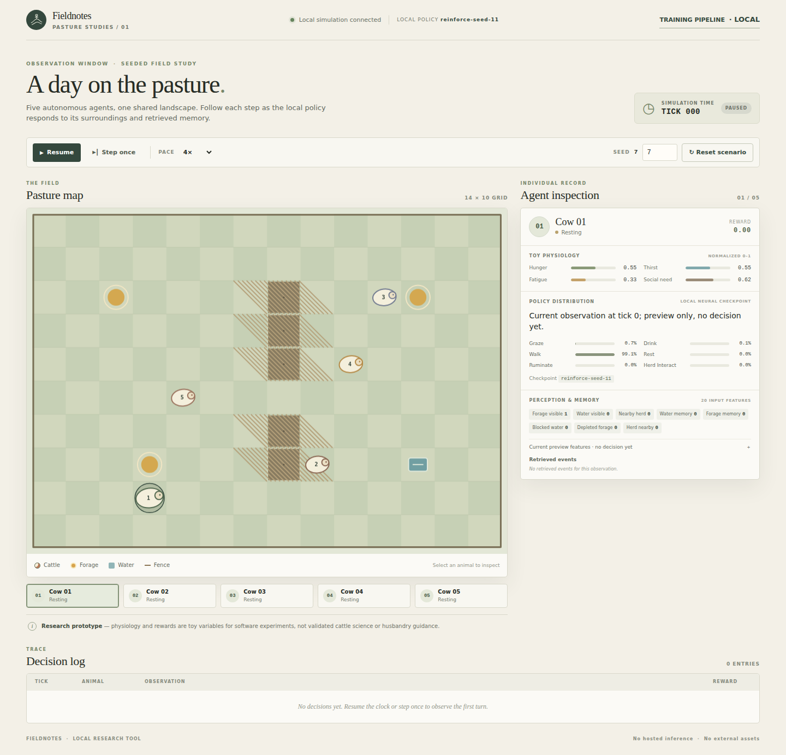
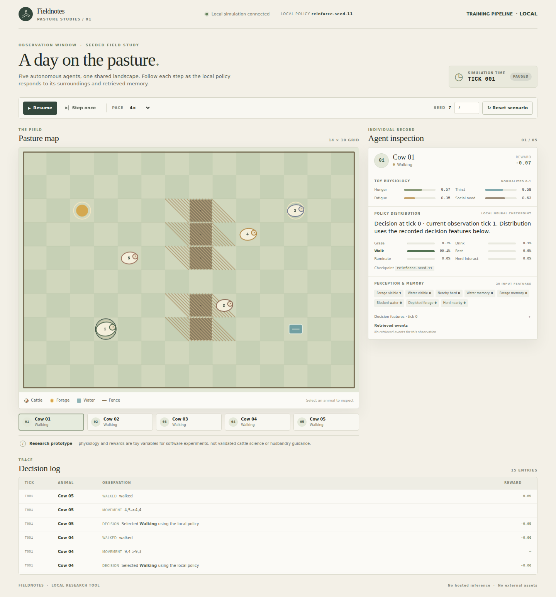
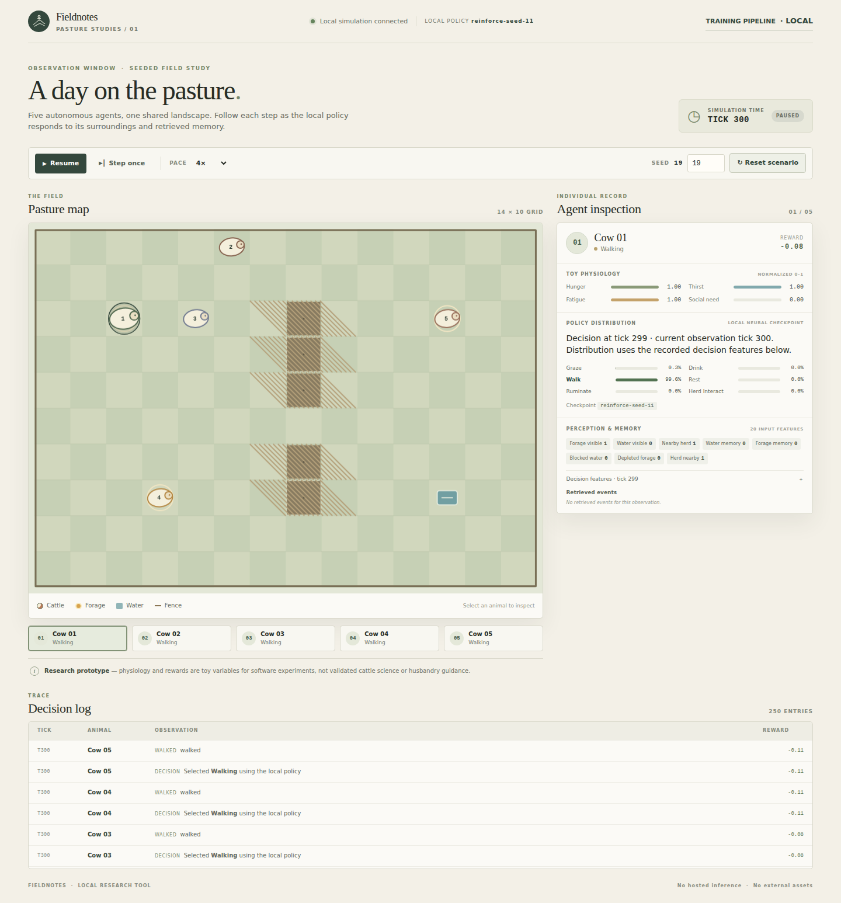

# Pasture Studies MVP 1 — End-to-End Validation Report

**Overall verdict: FAIL**  
**Browser/UI acceptance: PASS**  
**Deterministic evaluation harness and regression suite: PASS**

The application is a working, inspectable browser simulation, but the MVP 1 end-to-end validation does not pass its full research objective. The app does not define a virtual day, the trained policy collapses to `walk` in long rollouts and accumulates poor toy rewards, and intervention evidence is limited to decision-input pathways rather than full causal rollout effects. These failures are reported rather than corrected by tuning, exclusions, or changing scientific claims. **No MVP 2 work was started.**

## Scope and reproducibility

Validation used Python 3.12.3, Playwright 1.64.0, and headless Chromium 156.0.8078.4. Chromium ran locally; browser requests were loopback-only. The browser evidence connected to an already-running local server (`started_server: false`); the documented startup command reproduces the run from a stopped state. The active virtual environment was configured with the repository's pinned `numpy==1.26.4` requirement.

```sh
# Start the app if it is not already running
.venv/bin/python -m farm_sim.server

# Browser acceptance and screenshot capture
.venv/bin/python validation/playwright_mvp1.py

# Paired policy, intervention, and structural stress evaluation
.venv/bin/python validation/evaluate_policies.py

# Regression suite and Python compilation check
.venv/bin/python -m unittest discover -s tests -v
.venv/bin/python -m compileall -q farm_sim validation tests
```

Detailed machine-readable evidence is in [`playwright-results.json`](../artifacts/validation/browser/playwright-results.json) and [the policy evaluation JSON](../.omx/research/mvp1-policy-evaluation.json). The Playwright scenario is [`playwright_mvp1.py`](playwright_mvp1.py); policy evaluation is [`evaluate_policies.py`](evaluate_policies.py).

## Browser and UI validation — PASS

Real Playwright-driven headless Chromium checks found:

- HTTP 200, loaded application, and a rendered 860×615 2D canvas containing the farm.
- Exactly five cattle in the API and five animal selectors; selecting each selector updated the matching inspection panel and `aria-pressed` state.
- “Step once” advanced the clock from tick 0 to 1. All five animals changed position and had movement events. The inspector showed six action probabilities, selected action, decision features, and the distinct decision tick 0/current observation tick 1. Playwright asserted displayed action, each rounded probability, chosen row, and probability argmax against API state.
- Pause/resume toggled correctly. Repeating one step from seed 19 produced an identical serialized animal state.
- A further 300 deterministic logical ticks completed; the UI reached tick 300, all five agents had decisions and six probabilities, and 3,040 events were retained.
- No JavaScript console errors, uncaught page errors, or failed requests.

The **300-tick browser smoke run is not described as multiple days**. The application has no source-defined day duration or day-boundary semantics (`ticks_per_virtual_day` is null in browser evidence). The evaluator separately used 24 ticks/day × 3 days as a clearly labeled *synthetic evaluation convention*, not an implemented or biologically meaningful timescale.

### Screenshots

All three full-page screenshots were visually inspected at 1440px viewport width. The pasture, all five markers, controls, event log, and inspector are visible; no clipping, panel overlap, or missing map content was observed.

| Initial state | After first step | After 300 ticks |
|---|---|---|
|  |  |  |

The 300-tick screenshot also shows hunger, thirst, and fatigue saturated at 1.00 for the inspected cow under the current policy, an undesirable model result rather than a visual defect.

## Policy evaluation — harness PASS, learned-policy quality FAIL

The evaluator ran 3 policies against identical world seeds: five primary evaluation-world seeds (11, 29, 47, 83, 101), three held-out evaluation-world seeds (17, 23, 71), plus two paired structural stress scenarios. Each episode is 72 ticks under the explicit 24-tick synthetic-day convention. Total: **30 episodes and 2,160 simulation ticks** (10,800 animal decisions). Inference uses deterministic argmax. The exact action counts, per-tick reward trajectories, per-animal action counts, final and across-episode toy physiology, navigation outcomes, and seed/scenario details are in the JSON evidence.

### Starter-world primary and held-out evaluation results

The trained checkpoint metadata describes **2,000 episodes on a four-case one-step paired-memory task**. The world seeds below were evaluation worlds, not the checkpoint's training worlds. “Primary” and “held-out” refer only to this evaluation's seed split. Action shares aggregate all animal decisions within each group. Rewards are mean cumulative episode rewards in the toy simulator; they are not welfare, productivity, or real-cattle measures.

| Policy | Evaluation world group | Mean cumulative toy reward | Action distribution (graze / drink / walk / rest / ruminate / herd) | Positive-reward runs | Invalid action/probability vectors |
|---|---|---:|---|---:|---:|
| Untrained seed-11 policy | 5 primary evaluation seeds | −19.525 | 2.8% / 1.4% / 51.1% / 19.6% / 25.1% / 0% | 0/5 | 0 |
| Trained seed-11 policy | 5 primary evaluation seeds | −32.475 | 0% / 0% / **100%** / 0% / 0% / 0% | 0/5 | 0 |
| Deterministic heuristic baseline | 5 primary evaluation seeds | −40.882 | 61.8% / 15.8% / 14.2% / 0.8% / 0% / 7.4% | 0/5 | 0 |
| Untrained seed-11 policy | 3 held-out evaluation seeds | −13.260 | 2.1% / 0.7% / 29.9% / 16.0% / 51.2% / 0% | 0/3 | 0 |
| Trained seed-11 policy | 3 held-out evaluation seeds | −32.468 | 0% / 0% / **100%** / 0% / 0% / 0% | 0/3 | 0 |
| Deterministic heuristic baseline | 3 held-out evaluation seeds | −38.886 | 57.7% / 23.2% / 12.5% / 1.1% / 0% / 5.5% | 0/3 | 0 |

Mean final toy-drive values (hunger / thirst / fatigue / social need):

| Policy | Primary evaluation seeds | Held-out evaluation seeds |
|---|---|---|
| Untrained seed-11 policy | 0.980 / 1.000 / 0.480 / 0.589 | 0.876 / 1.000 / 0.305 / 0.288 |
| Trained seed-11 policy | **1.000 / 1.000 / 1.000 / 0.560** | **1.000 / 1.000 / 1.000 / 0.467** |
| Deterministic heuristic baseline | 1.000 / 1.000 / 0.922 / 0.711 | 1.000 / 1.000 / 0.942 / 0.733 |

The trained policy chose only `walk` in all 8 starter-world seeds, received no positive-reward episode, and ended with all three measured core toy drives saturated at 1.0. The untrained policy did better on mean toy reward in these runs; that does not establish general superiority, but it rules out claiming the trained checkpoint is effective from this evidence. All decisions were valid and positions remained in bounds.

### Navigation and held-out structural scenarios

The harness temporarily wrapped `navigate` and counted its result reasons. This distinguishes confirmed `no_reachable_target` outcomes from the broader no-movement proxy (which also includes reaching a target or a stationary action). Across the eight starter seeds, policy-specific exact counts and per-run call counts are present in the JSON. The two one-seed synthetic structural stress scenarios were:

| Scenario | Policy | Mean cumulative reward | Action distribution | `no_reachable_target` results / 360 animal-tick navigation attempts |
|---|---|---:|---|---:|
| 20×14 wide grid (seed 211) | Untrained | −27.294 | walk 72.5%, other 27.5% | 76 |
|  | Trained | −34.895 | walk 100% | 131 |
|  | Heuristic | −45.314 | graze 52.5%, drink 13.6%, herd 21.4%, walk 12.2%, rest 0.3% | 312 |
| Scarce/relocated resources (seed 307) | Untrained | −25.302 | walk 79.4%, other 20.6% | 208 |
|  | Trained | −30.701 | walk 100% | 278 |
|  | Heuristic | −36.579 | graze 39.7%, drink 30.6%, herd 12.5%, walk 15.8%, rest 1.4% | 316 |

Each scenario has one seed per policy comparison and is a synthetic software stress case, not an ecological or robust-generalization benchmark. Confirmed navigation failures are materially present and were not hidden by the separate no-movement statistic.

## Controlled perception/memory interventions

The script runs two kinds of decision-level probes for each policy (six paired comparisons per policy per kind):

1. Fixed 20-element policy-input vector perturbations (fixture-level sensitivity checks).
2. Production pathway probes calling `perceive` → `retrieve` → `encode_features` → `decide`, intervening on memory outcome, visible resource availability, water relocated outside view, and thirst. The output records changed feature names and action-probability deltas.

Production-path argmax changed in **3/6 untrained, 4/6 trained, and 2/6 heuristic** comparisons. For the trained policy, changed decisions were memory water success-vs-blocked, visible water available-vs-unavailable, water relocated out of view, and low-vs-high thirst; forage memory and forage availability comparisons changed probabilities but not the selected action. In the fixed-vector set, argmax changed in 0/6 untrained, 3/6 trained, and 2/6 heuristic comparisons.

These are controlled changes to inputs for a single decision—not full simulation counterfactual rollouts. Memory interventions change paired success/blocked encoded features; resource relocation changes multiple perception/distance inputs. Thus they show that some encoded inputs can causally affect immediate policy outputs under the probe, **not** that memory/perception improves long-horizon outcomes or produces biologically plausible behavior.

## Regression, defect disposition, and architecture audit

- `.venv/bin/python -m unittest discover -s tests -v`: **21 tests passed**.
- `compileall -q farm_sim validation tests`: passed.
- Policy evaluation re-run produced byte-identical JSON according to the evaluator lane’s checksum check.
- Playwright browser run: passed as detailed above.
- Structural invariants: PASS for component separation, exactly five agents, injected policy without heuristic fallback, deterministic inference, paired evaluation, and honest limitations. The independent architecture/domain audit recommends an overall validation FAIL because the day unit is undefined, trained behavior is poor, and causal evidence is not rollout-level.
- No application or model code bug was verified and fixed during this validation. The high `no_reachable_target` frequency and policy performance are reported as measured issues, not patched away. No validation evidence was excluded to improve results.

## Limitations and final disposition

- Toy normalized drives and reward terms are software variables, not validated physiology, welfare science, or husbandry guidance. No biological validation was performed.
- No app-level virtual day duration exists; only evaluator-assigned synthetic days are used.
- Evaluation covers 8 starter seeds, one evaluation seed for each of 2 structural stresses, and one saved checkpoint pair; it does not prove generalization.
- The trained policy's one-step input responsiveness does not contradict its poor rollout behavior. It remains an ineffective long-horizon controller under these conditions.
- No full-rollout causal ablation or real-world experiment was performed; small intervention samples are sensitivity probes.
- The baseline is deterministic and likewise performs poorly on toy reward, so it is a comparison reference, not a validated control.

**Final verdict: FAIL for the complete MVP 1 validation objective.** The local browser interaction, determinism, and regression contracts pass, but a meaningful multi-day claim is not available from the app clock, and the learned policy shows severe action collapse, negative reward trajectories, saturated toy drives, and navigation failures. Preserve this as the validation result; do not proceed to MVP 2 as part of this task.
